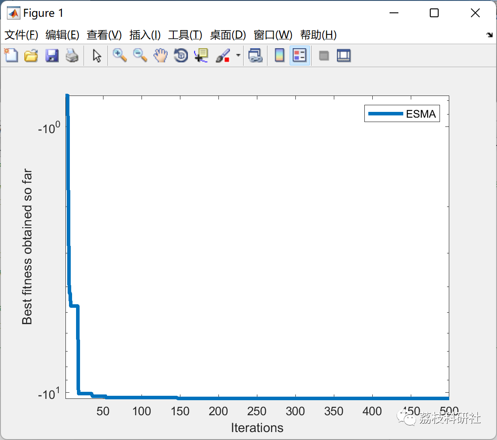

# Balanced Optimization Algorithm (EO) in combination with Mucoid Fungus Algorithm (SMA) (Matlab code implementation)

💥💥💥💞💞💞💞 Welcome to this blog❤️❤️❤️💥💥💥
🏆 Bloggers' Advantage: 🌞🌞🌞 The content of the blog strives to be rigorous in thought and clear in logic, for the convenience of readers.
⛳️ Mantra: The journey of a hundred miles is half done in the last ninety.
Litchi Research Society
Code Collection: Power System, Intelligent Algorithms and Applications, Neural Network Prediction, Path Planning, Optimized Scheduling, Workshop Scheduling, Image Processing, Signal Processing...
🎁Column Directory Link:
🌈🌈🌈🌟🌟🌟Electrical Code Intelligent Algorithm and Its Application Path Planning Neural Network Predictive Optimization Scheduling Image Processing Workshop Scheduling Signal Processing Romantic Her My Philosophical Thoughts Math Modeling Complete Code Matters
💥1 Overview
The Equilibrium Mud Mold Algorithm (ESMA) improves the Mud Mold Algorithm (SMA) by integrating the equilibrium optimization algorithm's concept of equilibrium. The improvement to the SMA is achieved through the integration of equilibrium practices, which updates the mud mold positions based on the equilibrium pool concept from the equilibrium optimizer (EO). The performance of ESMA is compared with well-known optimization algorithms and ranked according to Friedman's average rank when evaluating benchmark test problems.
📚2 Running Results
🎉3 References
[1]Naik, Manoj Kumar, et al. "An Entropy Minimization Based Multilevel Color Thresholding Technique for Analysis of Breast Thermograms Using Equilibrium Slime Mould Algorithm." Applied Soft Computing, Elsevier BV, Oct. 2021, p. 107955, doi:10.1016/j.asoc.2021.107955.  
🌈4 Matlab code implementation
Click the "Read Full Content" button at the bottom left of the article.

## Images

<!-- PAYMENT_BLOCK -->

## Get this dataset

- Payment link (Stripe): [Buy now](https://buy.stripe.com/3cs8yP7sY87d0vu9AB)
- Payment QR code: 

<!-- /PAYMENT_BLOCK -->
